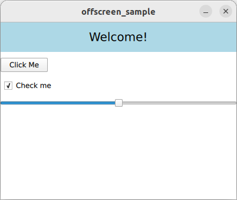

# 

# Offscreen Rendering

Rendering into a custom framebuffer, also known as off-screen rendering or rendering to a texture, plays a crucial role in numerous scenarios within computer graphics and game development. This repo is just an example that demonstrates how this can be achieved using the Qt framework (version 6).



## Build and run

```bash
cmake -B build -S .
cmake --build build --parallel
```

## Dependencies

This project uses Qt (Qt Quick, Qt QML, Qt OpenGL). The required Ubuntu packages for Qt and other dependencies are listed in the Dockerfile included in this repository.

## Usage

When running inside Docker, the output image will be written to a mounted folder. Specify the output path using the `--output` or `-o` CLI argument:

```sh
./build/offscreen_sample --output /output/image.png
```

Make sure to mount a host directory to `/output` in your Docker container to access the generated image.

## Example Docker run (headless mode)

```sh
docker run --rm -u $(id -u):$(id -g) -v $(pwd)/output:/output $(docker build . -q)
```

This will save the rendered image to the `output` folder on your host machine.
